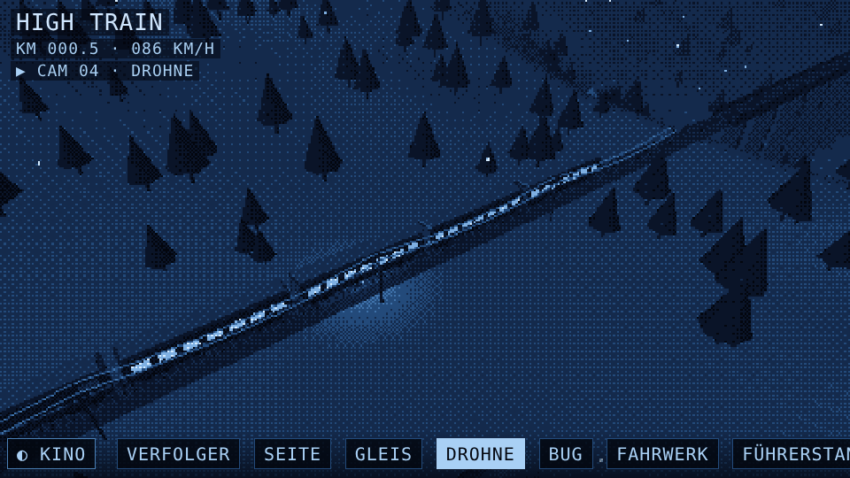
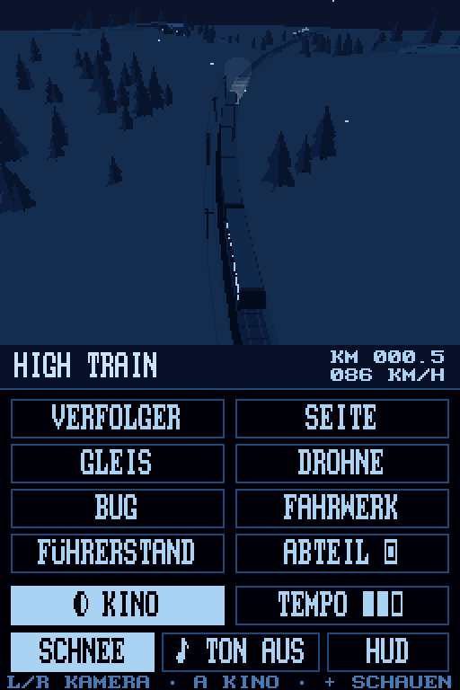

# Calm Train

Eine ruhige, endlose Zugfahrt durch eine verschneite Winternacht – im Pixel-Look mit Mondlicht, Sternenhimmel und dem gleichmäßigen *da-dum … da-dum* der Schienenstöße. Kein Ziel, keine Punkte: einfach zuschauen, die Kamera wechseln und mitfahren.

Die Strecke wird bei jedem Start neu erzeugt: Kurven, Steigungen, Brücken über Täler, kleine Bahnhöfe mit Laternen, Dörfer mit erleuchteten Fenstern, Nadelwälder, Telegrafenmasten mit durchhängenden Leitungen und Berge am Horizont.

| Web | Nintendo DSi |
|---|---|
|  |  |

## Versionen

| Plattform | Datei | Läuft auf |
|---|---|---|
| **Web** | [`index.html`](index.html) | Jeder aktuelle Browser (Handy, Tablet, PC) |
| **Nintendo DSi / DS** | [`nds/HighTrain.nds`](nds/HighTrain.nds) | DSi mit TWiLight Menu++ / Unlaunch, DS mit Flashkarte, Emulator (melonDS) |

---

## Web-Version

Einfach `index.html` im Browser öffnen – oder über GitHub Pages direkt online abspielen.

- **Kino-Modus** (Standard): automatische Kameraschnitte mit Dither-Überblendung, Vollbild, Menü blendet sich aus
- **8 wählbare Kameras** + 3 Kino-exklusive Einstellungen: Verfolger, Seite, Gleis, Drohne, Bug, Fahrwerk, Führerstand, Abteil, Kran, Vogel, Überholung
- **Führerstand & Abteil**: Innenansicht mit Fahrgästen, per Ziehen umsehen
- **Tempo** in drei Stufen, **Schnee** an/aus, **Pixelgröße** in vier Stufen
- **Ton** startet automatisch (wo der Browser es blockiert, beim ersten Antippen): synthetisiertes Rattern, Rumpeln und Brummen (Web Audio) – innen gedämpfter als außen; funktioniert auf dem iPhone auch bei Stummschalter
- Antippen blendet das Menü ein/aus

Technik: three.js (r128), eigener Post-Processing-Shader (7-Farben-Palette mit Bayer-Dithering), prozedurale Welt in Abschnitten, die laufend nachgebaut und wieder entfernt werden.

---

## Nintendo DSi / DS-Version

Eine eigenständige Neufassung in C für die 3D-Hardware des DS (der DSi-Browser kann kein WebGL).

- **Oberer Bildschirm**: 3D-Szene mit Nebel, Toon-Shading in der Blau-Palette, Scheinwerferkegel, Schnee
- **Unterer Bildschirm (Touch)**: alle Knöpfe der Web-Version; im Kino-Modus wird er nach einigen Sekunden abgedunkelt
- Alle 11 Kameras, Kino-Modus, Tempo, Schnee und Ton (Rattern an den Schienenstößen)

### Installation

1. `nds/HighTrain.nds` auf die SD-Karte kopieren (z. B. nach `/roms/nds/`)
2. Über TWiLight Menu++ oder Unlaunch starten

### Steuerung

| Taste | Funktion |
|---|---|
| Touchscreen | Kamera-Knöpfe, Kino, Tempo, Schnee, Ton, HUD |
| L / R | vorige / nächste Kamera |
| A | Kino-Modus an/aus |
| Steuerkreuz | im Führerstand / Abteil umsehen |
| X | Tempo |
| Y | Schnee |
| SELECT | Ton an/aus |
| START | HUD ein/aus |

### Selbst bauen

Benötigt das [BlocksDS SDK](https://github.com/blocksds/sdk) und `arm-none-eabi-gcc`.

```bash
cd nds
make            # erzeugt hightrain.nds
```

`tools/mkassets.py` erzeugt die Schrift-Header aus dem libnds-Standardfont (Pfad im Skript ggf. anpassen).

---

## Projektstruktur

```
index.html          Web-Version (eine Datei)
nds/
  HighTrain.nds     fertige ROM
  source/           C-Quellcode (main.c, font8.h)
  tools/            Asset-Skript
  Makefile, icon.bmp
screenshots/
```
